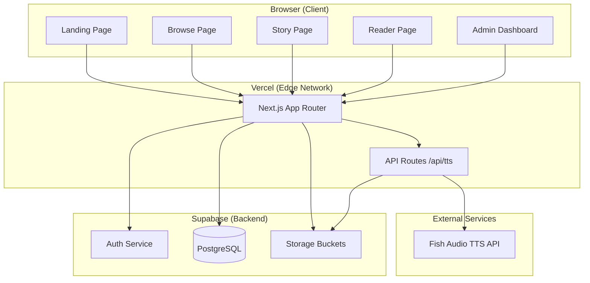
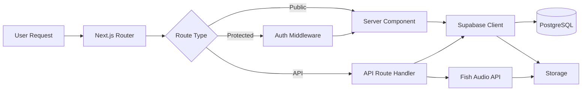
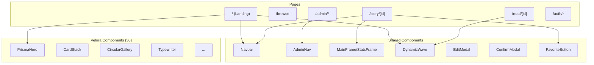
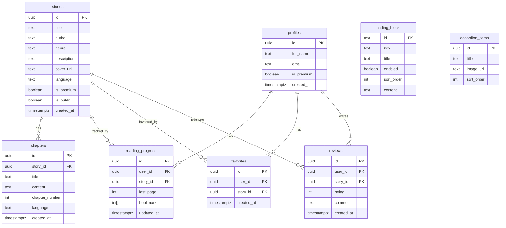
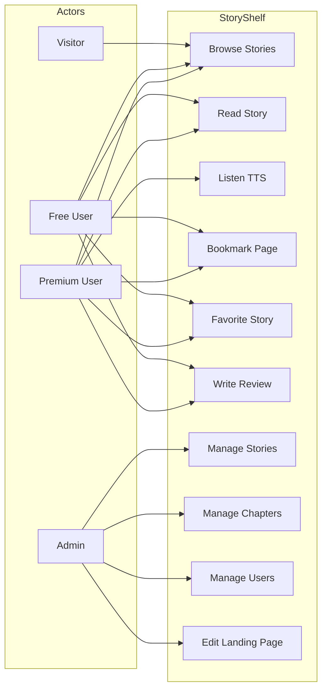
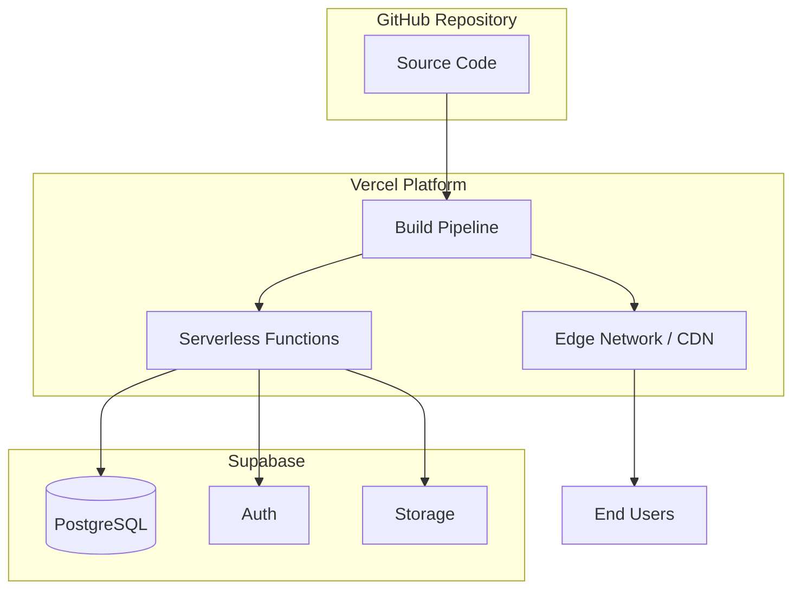

# Software Requirements Specification (SRS)
## StoryShelf — Digital Reading Platform

**Version:** 1.0  
**Date:** October 31, 2026  
**Author:** Sayed Ali Hashem  
**Status:** Draft

---

## 1. Introduction

### 1.1 Purpose
This document specifies the software requirements for **StoryShelf**, a digital reading platform that allows users to discover, read, and manage stories and e-books with a realistic page-flip reading experience.

### 1.2 Scope
StoryShelf is a web-based platform providing:
- A public landing page with featured stories, reviews, and membership plans
- A browseable story catalog with search and filtering
- A realistic book-reader with page-flip animation, TTS narration, bookmarks, and zoom
- An admin dashboard for managing stories, chapters, users, reviews, and landing page content
- Multi-language support (English/Arabic) with RTL layout
- Premium/free content gating with membership tiers

### 1.3 Definitions
| Term | Definition |
|------|-----------|
| Story | A published work with metadata (title, author, genre, cover, description) |
| Chapter | A subdivision of a story containing HTML content |
| Reader | The page-flip book reading interface |
| TTS | Text-to-Speech narration |
| Premium | Content requiring paid membership |

### 1.4 References
- Next.js 16 Documentation
- Supabase Documentation
- Turn.js 4th Release (v4.1.0)
- Fish Audio API Documentation

---

## 2. Overall Description

### 2.1 Product Perspective
StoryShelf is a standalone web application built with Next.js + Supabase, deployed on Vercel. It consists of:
- **Frontend**: Next.js (App Router) with React, Tailwind CSS, shadcn/ui
- **Backend**: Supabase (PostgreSQL, Auth, Storage)
- **Deployment**: Vercel with CDN caching

### 2.2 User Classes
| User Class | Description | Access Level |
|-----------|-------------|-------------|
| Visitor | Unauthenticated user browsing the catalog | Read-only public content |
| Free User | Registered user with free account | Free stories + previews |
| Premium User | Paid subscriber (VIP) | All stories + TTS + offline |
| Admin | Platform administrator | Full CRUD on all entities |

### 2.3 Operating Environment
- **Browser**: Chrome, Firefox, Safari, Edge (latest 2 versions)
- **Devices**: Desktop (primary), Tablet, Mobile
- **Server**: Vercel Edge Network
- **Database**: Supabase PostgreSQL
- **Storage**: Supabase Storage (covers, audio)

### 2.4 Design Constraints
- Page ratio: 8:13 (0.615:1) portrait, matching cover images (1280×2080)
- ~150 words per page with sentence-aware splitting
- Arabic RTL must not break application layout
- Dark mode: light buttons → dark text, dark orange buttons → light text

---

## 3. System Architecture

### 3.1 Architecture Diagram



### 3.2 Data Flow Diagram



### 3.3 Component Architecture



---

## 4. Functional Requirements

### 4.1 Landing Page (FR-LP)
| ID | Requirement | Priority |
|----|-------------|----------|
| FR-LP-01 | Display hero section with title, description, and CTA buttons | High |
| FR-LP-02 | Display stats frame (stories count, avg rating, languages, free-to-try) | High |
| FR-LP-03 | Display featured story with cover, title, author, description | High |
| FR-LP-04 | Display "Most Read" card stack | Medium |
| FR-LP-05 | Display story showcase (circular gallery) | Medium |
| FR-LP-06 | Display 3D book gallery | Low |
| FR-LP-07 | Display reader reviews (latest 5-star) | Medium |
| FR-LP-08 | Display membership plans (Free/VIP) | High |
| FR-LP-09 | Display explore stories section with search | Medium |
| FR-LP-10 | All sections toggleable and reorderable via admin | Medium |

### 4.2 Browse Page (FR-BP)
| ID | Requirement | Priority |
|----|-------------|----------|
| FR-BP-01 | List all public stories with cover, title, author, genre | High |
| FR-BP-02 | Filter by genre | Medium |
| FR-BP-03 | Search by title/author | Medium |
| FR-BP-04 | Toggle favorite on stories | Medium |

### 4.3 Story Detail Page (FR-SP)
| ID | Requirement | Priority |
|----|-------------|----------|
| FR-SP-01 | Display story cover in MainFrame | High |
| FR-SP-02 | Display title, author, genre, language badge | High |
| FR-SP-03 | Premium/Free badge | High |
| FR-SP-04 | Language selector (En/Ar/Both) | High |
| FR-SP-05 | "Continue Reading" link to last read page | Medium |
| FR-SP-06 | Read-more expansion for descriptions >150 words | Medium |
| FR-SP-07 | Chapter list by language | High |
| FR-SP-08 | Related stories | Low |
| FR-SP-09 | Social sharing (copy link) | Medium |
| FR-SP-10 | Favorite toggle | Medium |

### 4.4 Reader Page (FR-RP)
| ID | Requirement | Priority |
|----|-------------|----------|
| FR-RP-01 | Page 0 displays full-bleed cover image | High |
| FR-RP-02 | Content split into ~150 words per page | High |
| FR-RP-03 | Sentence-aware splitting (extend to next period) | Medium |
| FR-RP-04 | "CHAPTER ENDED" page after last chapter | Medium |
| FR-RP-05 | Turn.js page-flip animation (bending from edge) | High |
| FR-RP-06 | Display modes: single, double, auto | Medium |
| FR-RP-07 | Page ratio: 8:13 (400×650) | High |
| FR-RP-08 | Zoom (max 150%) scales book + text | Medium |
| FR-RP-09 | Chapter-linked TOC by language | High |
| FR-RP-10 | Functional bookmarks (add/remove/jump) | Medium |
| FR-RP-11 | Page numbers | Low |
| FR-RP-12 | TTS narration with per-language voices | High |
| FR-RP-13 | TTS audio cached (IndexedDB + Supabase Storage) | Medium |
| FR-RP-14 | Reading progress bar | Medium |
| FR-RP-15 | Keyboard shortcuts (arrows, space, +/-) | Medium |
| FR-RP-16 | Night mode toggle | Low |
| FR-RP-17 | Auto-play TTS | Low |
| FR-RP-18 | Font selector | Low |
| FR-RP-19 | Share modal (copy link, social) | Medium |
| FR-RP-20 | Arabic RTL layout support | High |

### 4.5 Admin Dashboard (FR-AD)
| ID | Requirement | Priority |
|----|-------------|----------|
| FR-AD-01 | Stats overview (stories, chapters, users, premium) | High |
| FR-AD-02 | Recent stories list with covers | Medium |
| FR-AD-03 | Unified admin navigation (all pages) | High |

### 4.6 Story Management (FR-SM)
| ID | Requirement | Priority |
|----|-------------|----------|
| FR-SM-01 | Add new story (modal popup) | High |
| FR-SM-02 | Edit story (all fields including cover upload) | High |
| FR-SM-03 | Delete story (confirm modal) | High |
| FR-SM-04 | Toggle publish status | Medium |
| FR-SM-05 | Multi-language (En/Ar/Both) | High |
| FR-SM-06 | Premium/free toggle | Medium |
| FR-SM-07 | Cover image upload to Supabase Storage | High |

### 4.7 Chapter Management (FR-CM)
| ID | Requirement | Priority |
|----|-------------|----------|
| FR-CM-01 | Add chapter (title, content, language) | High |
| FR-CM-02 | Edit chapter (title, content, number, language) | High |
| FR-CM-03 | Delete chapter (confirm modal) | High |
| FR-CM-04 | Auto chapter numbering | Medium |
| FR-CM-05 | Language tabs (En/Ar) | High |

### 4.8 User Management (FR-UM)
| ID | Requirement | Priority |
|----|-------------|----------|
| FR-UM-01 | List users with profile info | High |
| FR-UM-02 | Edit user (modal) | Medium |
| FR-UM-03 | Toggle premium status | Medium |

### 4.9 Landing Page Admin (FR-LA)
| ID | Requirement | Priority |
|----|-------------|----------|
| FR-LA-01 | Toggle blocks on/off | High |
| FR-LA-02 | Reorder blocks (up/down) | Medium |
| FR-LA-03 | Edit block-specific fields | Medium |
| FR-LA-04 | Save all blocks | High |

### 4.10 Authentication (FR-AU)
| ID | Requirement | Priority |
|----|-------------|----------|
| FR-AU-01 | Sign up with email/password | High |
| FR-AU-02 | Sign in | High |
| FR-AU-03 | Forgot password | Medium |
| FR-AU-04 | Profile page with tabs (history, favorites, settings) | Medium |

---

## 5. Non-Functional Requirements

### 5.1 Performance
- Page load time < 3 seconds on 3G
- TTS audio cached for instant replay
- Image optimization via Next.js Image
- Service worker for offline caching

### 5.2 Security
- Row Level Security (RLS) on all Supabase tables
- Auth middleware on protected routes
- API key stored in environment variables only
- CORS configured for API routes

### 5.3 Usability
- Responsive design (mobile, tablet, desktop)
- Dark mode support
- Arabic RTL layout
- Keyboard navigation in reader

### 5.4 Reliability
- Graceful degradation when TTS fails (fallback to OpenAI)
- Error alerts on save failures
- Loading skeletons for async content

---

## 6. Database Schema

### 6.1 Entity Relationship Diagram



---

## 7. Use Cases

### 7.1 Use Case Diagram



---

## 8. API Endpoints

| Method | Endpoint | Description | Auth |
|--------|----------|-------------|------|
| GET | /api/tts?text=...&lang=en | Generate TTS audio | Public |
| POST | /api/tts | Generate TTS with body params | Public |

### TTS Request/Response
```
GET /api/tts?text=Hello+world&lang=en
Response: audio/mpeg (binary)
Cache: Supabase Storage (audio bucket) + IndexedDB (client)
```

---

## 9. Deployment Architecture



---

## 10. Testing Strategy

| Test Type | Scope | Tools |
|-----------|-------|-------|
| Unit | Components, utilities | Jest + React Testing Library |
| Integration | API routes, DB queries | Supabase local |
| E2E | User flows (browse, read, admin) | Playwright |
| Visual | Responsive, dark mode, RTL | Manual + screenshots |

---

## 11. Glossary

| Term | Definition |
|------|-----------|
| SRS | Software Requirements Specification |
| RLS | Row Level Security |
| TTS | Text-to-Speech |
| RTL | Right-to-Left (Arabic layout) |
| CDN | Content Delivery Network |
| ISR | Incremental Static Regeneration |
| SPA | Single Page Application |
| SSR | Server-Side Rendering |
| CSR | Client-Side Rendering |
